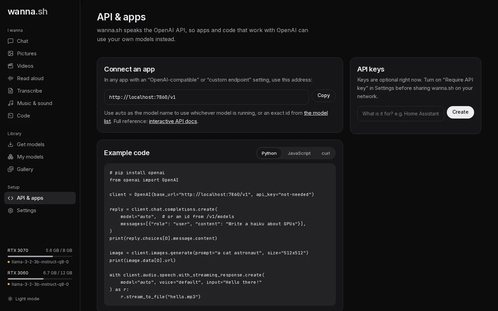

wanna.sh speaks the OpenAI API, so most apps, libraries and plugins that work with OpenAI can use your local models
instead. The **API & apps** page in wanna.sh has the address to use, and example code you can copy.



## The address

In any app with an *OpenAI-compatible*, *custom endpoint* or *base URL* setting, use:

```text
http://localhost:7860/v1
```

- **API key:** any text works, unless you've turned on [Require API key](/docs/guides/network/). Some apps insist on a
  key; type `not-needed`.
- **Model:** use `auto` for whichever model of the right kind is running (or, if none is, the one you installed most
  recently), or a model id from `http://localhost:7860/v1/models`.

## Python

```python
# pip install openai
from openai import OpenAI

client = OpenAI(base_url="http://localhost:7860/v1", api_key="not-needed")

reply = client.chat.completions.create(
    model="auto",
    messages=[{"role": "user", "content": "Write a haiku about GPUs"}],
)
print(reply.choices[0].message.content)

image = client.images.generate(prompt="a cat astronaut", size="512x512")
print(image.data[0].url)

with client.audio.speech.with_streaming_response.create(
    model="auto", voice="default", input="Hello there!"
) as r:
    r.stream_to_file("hello.mp3")
```

## JavaScript

```js
// npm install openai
import OpenAI from "openai";

const client = new OpenAI({ baseURL: "http://localhost:7860/v1", apiKey: "not-needed" });

const reply = await client.chat.completions.create({
  model: "auto",
  messages: [{ role: "user", content: "Write a haiku about GPUs" }],
});
console.log(reply.choices[0].message.content);
```

## curl

```bash
curl http://localhost:7860/v1/chat/completions \
  -H "Content-Type: application/json" \
  -d '{"model": "auto", "messages": [{"role": "user", "content": "Hello!"}]}'
```

## What's supported

Chat (including streaming, tool calls with GGUF models, and pictures for models that can see), text completions,
image generation and editing, text to speech, transcription and translation, and video. See the
[API reference](/docs/api/) for details and the differences from OpenAI.

## From another device

To use wanna.sh from another computer or phone on your network, see
[Share wanna.sh on your network](/docs/guides/network/).
