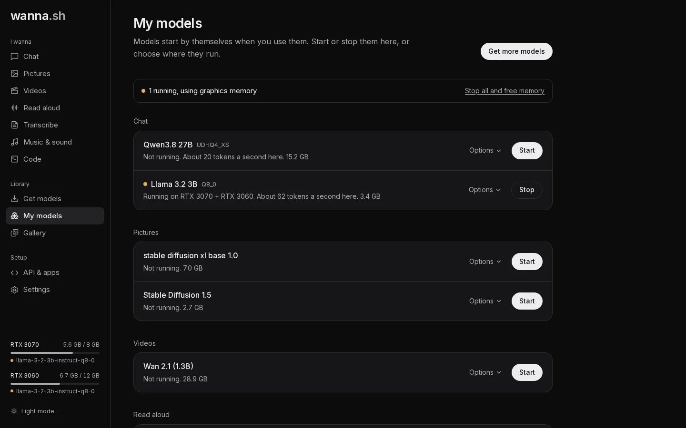

wanna.sh is built to get the most from the hardware you have, whether that's one graphics card, multiple cards, or none.

## Models start by themselves

You don't need to start models by hand: the first time you use one, wanna.sh loads it. **My models** shows what's
running, on which card, and how fast chat models reply on your computer (for example, *About 20 tokens a second here*,
measured from your own use).

- **Start** and **Stop** load or unload a model.
- **Stop all and free memory** unloads everything.
- **Settings → Stop idle models after** unloads models you haven't used for 5 minutes, 15 minutes or an hour.

If a new model needs room, wanna.sh unloads the models you used least recently first.

## Where a model runs

Under **My models → Options → Where to run it**:

| Choice | What it does |
| --- | --- |
| **Automatic (recommended)** | Puts the model on the smallest graphics card it fits on, leaving bigger cards free. If it fits on none, it shares it across your cards. |
| *A specific card* | Always use that card. |
| **Share across all graphics cards** | Split the model across every card. |
| **Processor only (slow)** | Don't use a graphics card. |

Changes apply the next time the model starts.

### Multiple graphics cards

- **Chat models** are split by layers across cards (llama.cpp's *tensor split*), weighted by each card's free memory.
- **Picture and video models** are spread across cards with diffusers' balanced device map.
- **Voice, transcription and music models** use a single card.

Cards don't need to match. For example, an 8 GB and a 12 GB card together run a chat model that needs about 19 GB.

## Memory for conversation

For chat models, **Memory for conversation** (under **Options**) sets how much text the model keeps in mind, from 8K
up to the most the model supports (as much as 128K). More memory takes more graphics memory.

Before a chat model starts, wanna.sh plans exactly how it fits using llama.cpp's own planner, and shows each option as
fast (fits fully on your graphics cards) or slower (part of it would run on the processor). **Recommended here** is the
most that fits fully on your cards.

## Protecting your computer

Models that don't fit on the graphics card can spill into system memory. Before starting one, wanna.sh checks there is
enough free memory, and it watches memory while models run, stopping a model before your computer runs out.

On Windows with WSL2, see the note on [WSL2 memory](/docs/start/install/#windows-with-wsl2).

## No graphics card?

Everything still works on the processor, just much more slowly. Small chat models (3B or less) are usable; pictures,
music and especially video will take a long time.

## Macs

On a Mac with Apple Silicon, wanna.sh uses its built-in GPU: chat through Apple's Metal, and pictures, video, voices,
transcription and music through PyTorch (on macOS 15 or newer). The GPU shares the Mac's memory, and macOS lets it use
only part of it; wanna.sh asks macOS how much and shows it as the graphics memory in **Settings** and the model
ratings. Close other apps to leave more of it free.
