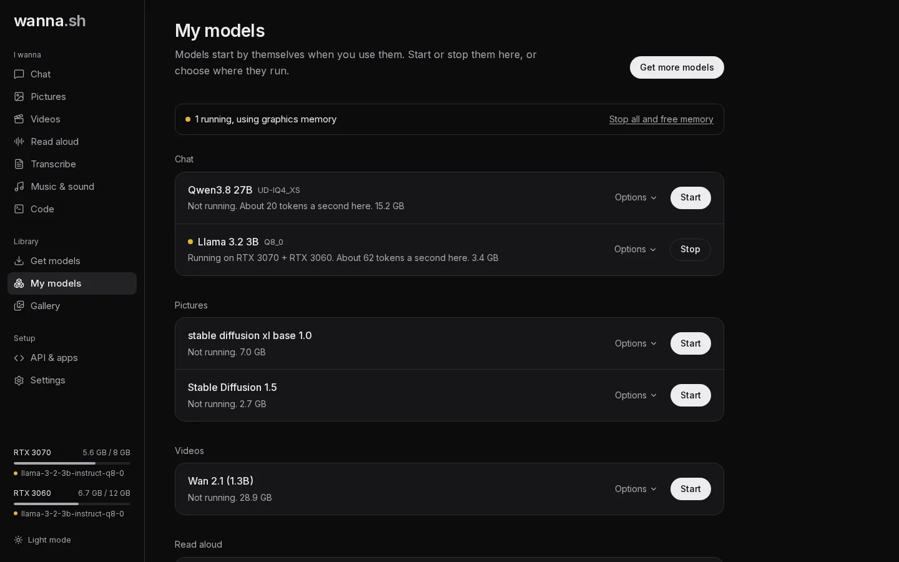

wanna.sh is built to get the most from the hardware you have, whether that's one graphics card, multiple cards, or none.

## Models start by themselves

You don't need to start models by hand: the first time you use one, wanna.sh loads it. **My models** shows what's
running, on which card, and how fast chat models reply on your computer (for example, *About 20 tokens a second here*,
measured from your own use).

- **Start** and **Stop** load or unload a model.
- **Stop all and free memory** unloads everything.
- **Settings → Models & memory → Stop idle models after** unloads models you haven't used for 5 minutes, 15 minutes or an hour.

If a new model needs room, wanna.sh unloads the models you used least recently first.

## Where a model runs

Under **My models → Options → Where to run it**:

| Choice | What it does |
| --- | --- |
| **Automatic (recommended)** | Puts the model on the smallest graphics card it fits on, leaving bigger cards free. If it fits on none, it shares it across your cards. |
| *A specific card* | Always use that card. |
| **Share across all graphics cards** | Split the model across every card. |
| **Processor only (slow)** | Don't use a graphics card. |

Changes apply the next time the model starts.

### Multiple graphics cards

- **Chat models** are split by layers across cards (llama.cpp's *tensor split*), weighted by each card's free memory.
- **Picture and video models** are spread across cards with diffusers' balanced device map.
- **Voice, transcription and music models** use a single card.

Cards don't need to match. For example, an 8 GB and a 12 GB card together run a chat model that needs about 19 GB.

## Memory for conversation

For chat models, **Memory for conversation** (under **Options**) sets how much text the model keeps in mind, from 8K
up to the most the model supports (as much as 128K). More memory takes more graphics memory.

Before a chat model starts, wanna.sh plans exactly how it fits using llama.cpp's own planner, and shows each option as
fast (fits fully on your graphics cards) or slower (part of it would run on the processor). **Recommended here** is the
most that fits fully on your cards.

## Protecting your computer

Models that don't fit on the graphics card can spill into system memory. Before starting one, wanna.sh checks there is
enough free memory, and it watches memory while models run, stopping a model before your computer runs out. Parts of a
model read from its file don't count: the system frees those by itself when it needs the room. Free
swap space counts as memory: with swap, a model that needs more memory than is free makes your computer slower for a
while instead of being stopped.

On Windows with WSL2, see the note on [WSL2 memory](/docs/start/install/#windows-with-wsl2).

## Models bigger than memory

A chat model bigger than your graphics and system memory together can still run, if you allow it: turn on
**Settings → Models & memory → Run models bigger than memory**. It's off until you do.

Such a model runs by reading what doesn't fit from your drive as it writes. llama.cpp maps the model file into memory
instead of loading it: your graphics cards hold what they can, the operating system keeps as much of the rest as fits
in spare memory, and reads the remainder from the drive when a token needs it.

- **Mixture-of-experts models** (Kimi, DeepSeek, Qwen "A3B" models and others) are the ones worth running this way:
  each token uses only a few of the model's experts, so it reads a small share of the model. Kimi K3 uses 16 of its
  896 experts per token, for example.
- **Other models** need every weight for every token, so they read the whole model from the drive each time and are
  impractically slow.
- **It is slow.** Before you download one, wanna.sh estimates on your computer how long a token takes, how long it
  takes to read your message before replying, and how long starting takes. As a guide, Kimi K3 (2.8 trillion parameters) in
  its 595 GB UD-IQ1_S version is estimated at about 7 seconds a token, a minute to read a short message and 6 minutes to
  start, on a PC with 32 GB of memory, 20 GB of graphics memory and an NVMe drive. Qwen3-30B-A3B at full precision
  (61 GB, 3 of its 30 billion parameters used per token) measured 4 to 6 tokens a second on the same PC. Smaller isn't always faster: a version that keeps the parts every token uses larger can be
  slower, and the estimate for each version shows it. More memory helps most: what memory holds isn't read from the
  drive.
- **Reading your message takes a while too.** Reading a prompt sends tokens to almost every expert, so it reads most of
  the model from the drive for every 400 words or so. The first message after it starts is the slowest, because
  nothing is in memory yet.
- **The estimate is a range** when the speed depends on the model: some models keep using the same few experts, which
  then stay in memory, so they run faster than when experts are used evenly (as Kimi K3 is trained to).
- **Use a fast SSD.** wanna.sh measures the drive your models are saved on the first time it matters (it writes and
  reads a 2 GB test file, about ten seconds) and shows the result in **Settings → Models & memory**, with **Measure again**. A hard disk is
  far too slow. Reading doesn't wear out an SSD, but the drive stays busy, so other programs may feel slower.
- **On Windows with WSL2, give WSL more memory.** WSL gets half of the PC's memory by default; raising it in
  [`.wslconfig`](https://learn.microsoft.com/windows/wsl/wsl-config) helps these models most. Where the model is
  stored matters too. Tested with a 61 GB model on a PC with 32 GB (16 GB for WSL):
  - From a Windows drive such as `/mnt/c`, which WSL reads through file sharing, it took 16 to 21 minutes to start
    (on Linux, llama.cpp reads the whole model as it starts), then wrote 1.1 to 1.7 tokens a second.
  - From WSL's own disk it started in about a minute, but wrote only about 0.35 tokens a second.

  The Windows drive was likely faster once running because Windows' own memory keeps part of the model too.
  wanna.sh says when your models are on a Windows drive. wanna.sh warns when
  your models are on a Windows drive.
- Your download needs room: big versions can take hundreds of gigabytes. To keep models on another drive, move your
  [data folder](/docs/reference/files/) with `WANNA_HOME`.

While one runs, **My models** says *reading the rest from your drive*, and its speed estimate is under **Options**.

## No graphics card?

Everything still works on the processor, just much more slowly. Small chat models (3B or less) are usable; pictures,
music and especially video will take a long time.

## Macs

On a Mac with Apple Silicon, wanna.sh uses its built-in GPU: chat through Apple's Metal, and pictures, video, voices,
transcription and music through PyTorch (on macOS 15 or newer). The GPU shares the Mac's memory, and macOS lets it use
only part of it; wanna.sh asks macOS how much and shows it as the graphics memory in **Settings → This computer** and the model
ratings. Close other apps to leave more of it free.
