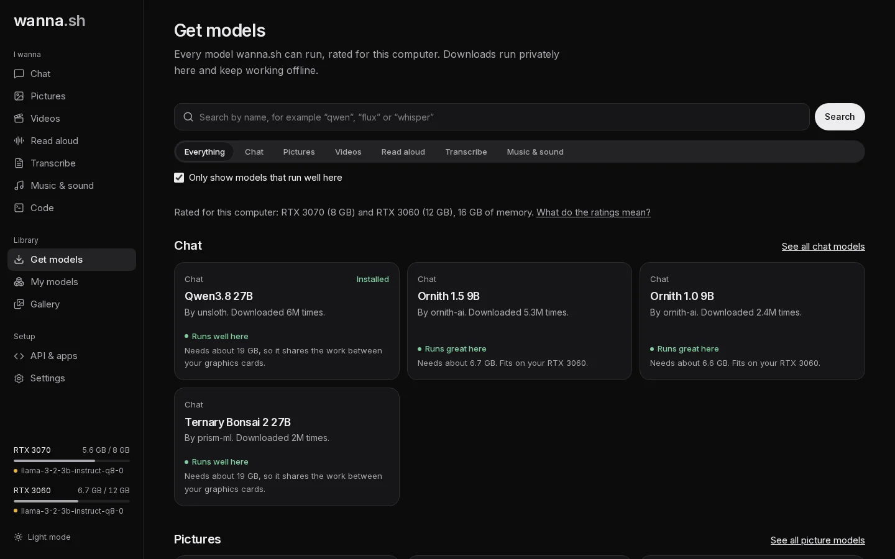

**Get models** lists the models wanna.sh can run, from [Hugging Face](https://huggingface.co), grouped by what they do:
Chat, Pictures, Videos, Read aloud, Transcribe, Music & sound, and Document search (the small search models that
power [Knowledge](/docs/tutorials/knowledge/)).

## Finding a model

- Pick a category, or **Search** by name, for example *qwen*, *flux* or *whisper*.
- **Only show models that run well here** hides models that would be slow or won't fit. Untick it to see everything.
- Models marked **Tested with wanna.sh** have been run on real hardware with the app.

## What the ratings mean

Each model is rated against your computer's graphics cards and memory:

| Rating | Meaning |
| --- | --- |
| **Runs great here** | Fits on one of your graphics cards. The fastest option. |
| **Runs well here** | Too big for one card, but fits when shared across your cards (chat, picture and video models). |
| **Runs, but slowly** | Part of it runs on the processor or streams from system memory. It works, but replies and results come slowly. |
| **Runs from your drive, very slowly** | A chat model bigger than your graphics and system memory together. It reads what doesn't fit from your drive while it writes. To run one, turn on [Run models bigger than memory](/docs/guides/hardware/#models-bigger-than-memory). |
| **Too big for this computer** | Needs more memory than you have. |

The rating says how much graphics memory the model needs **while it runs**, for example *Needs about 9.3 GB of
graphics memory to run*. That's more than its download size, because a model needs working room as well as its
weights: a picture model that downloads as 6.9 GB needs about 9.3 GB to make 1024 px pictures. The download size is on
the **Download** button. Ratings are worked out for *your* computer, so the same model can be rated differently on
another one.

## Choosing a version

Many models come in several versions (*quantizations*): the same model compressed by different amounts. When you open a
model you'll see **Choose a version**:

- Smaller versions download faster and use less memory.
- Bigger versions are smarter. Chat versions show their **bits per weight**: about 4 or more is close to the original,
  below 3 the model makes noticeably more mistakes, especially with facts, maths and code. When you pick a version
  that compressed, wanna.sh says so before you download it.
- **Best for you** marks the highest quality version that runs well on your computer. It's selected for you.
- For chat models, wanna.sh estimates how fast the version you pick will write on this computer, from the model's own
  file (read from Hugging Face without downloading it) and measured speeds of your graphics cards, memory and drive.
  Once a model has run, **My models** shows the speed measured from your own use instead. Ratings in the lists go by
  size alone; once a version's file has been read, its rating can change. Some models (such as Qwen3.8 Flash Next and
  Gemma 4) carry a large table that is looked up a little at a time and never loaded into memory, so they fit where
  their size suggests they wouldn't.
- A version bigger than the free space on your drive can't be downloaded; wanna.sh says how much room it needs.

Some chat models also say **Can also look at pictures you attach**. For those, wanna.sh downloads the extra file they
need to see pictures.

Picture models in GGUF files (such as Qwen-Image 2.1 and Qwen-Image-Edit) come in versions too. Their download also
includes the parts that read your description and decode the picture, from the model's original release when the
upload doesn't carry them, so it's bigger than the version's own file. Their rating counts the part that reads your
description separately: it's used once per picture, so it can sit in system memory.

## Downloading

Press **Download**. Progress shows at the bottom of the sidebar and on the model's page, and you can keep using the app
meanwhile. wanna.sh downloads only the files the model needs.

- If you close wanna.sh or lose your connection, the download **resumes** where it left off next time.
- If a download stalls, it restarts itself.

Downloaded models appear in **My models**, and in the model menus on each page.

## Models that need permission

Some models (such as FLUX.1 [dev] and some Llama and Gemma repositories) ask you to accept their licence on Hugging
Face before downloading:

1. Sign in at [huggingface.co](https://huggingface.co), open the model's page and accept its terms.
2. Create a **read** token at [huggingface.co/settings/tokens](https://huggingface.co/settings/tokens).
3. Paste it into **Settings → Hugging Face account**.

## Removing models

Open **My models**, choose **Options** on a model and press **Delete model** to free up its disk space.
