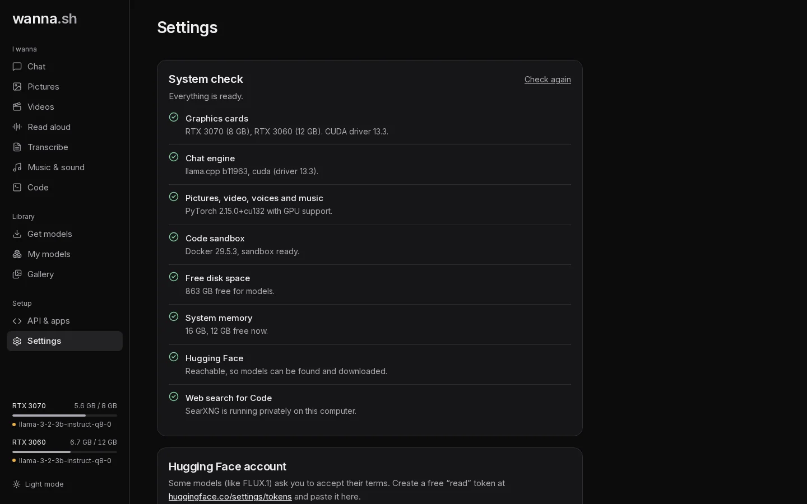

## System check

Checks that each part of wanna.sh is ready on this computer and says how to fix anything that isn't. See
[Troubleshooting](/docs/reference/troubleshooting/#the-system-check). Press **Check again** after fixing something.

## Hugging Face account

A Hugging Face **read** token, for models that ask you to accept their terms first, such as FLUX.1 [dev]. Create one at
[huggingface.co/settings/tokens](https://huggingface.co/settings/tokens). Once saved, only the first and last few
characters are shown. **Remove** deletes it. You can also set the `HF_TOKEN` environment variable instead.

## Web search for Code

An optional [Brave Search API](https://brave.com/search/api/) key. Without one, [Code](/docs/tutorials/code/#web-search)
searches through a private SearXNG instance on your computer. With one, Brave is tried first.

## Memory

| Setting | Options | What it does |
| --- | --- | --- |
| **Stop idle models after** | Never, 5 minutes, 15 minutes, 1 hour | Unloads models you haven't used for a while, freeing graphics memory. |
| **Chat memory** | Short (4K), Standard (8K), Long (16K), Very long (32K) | How much of a conversation chat models remember, unless set per model in **My models → Options**. |

## Security

**Require API key**: when on, every request to the API needs a key from **API & apps**. The interface on this computer
keeps working without one. Turn it on before [sharing wanna.sh on your network](/docs/guides/network/).

Settings are saved in `~/.wanna/settings.json`.
