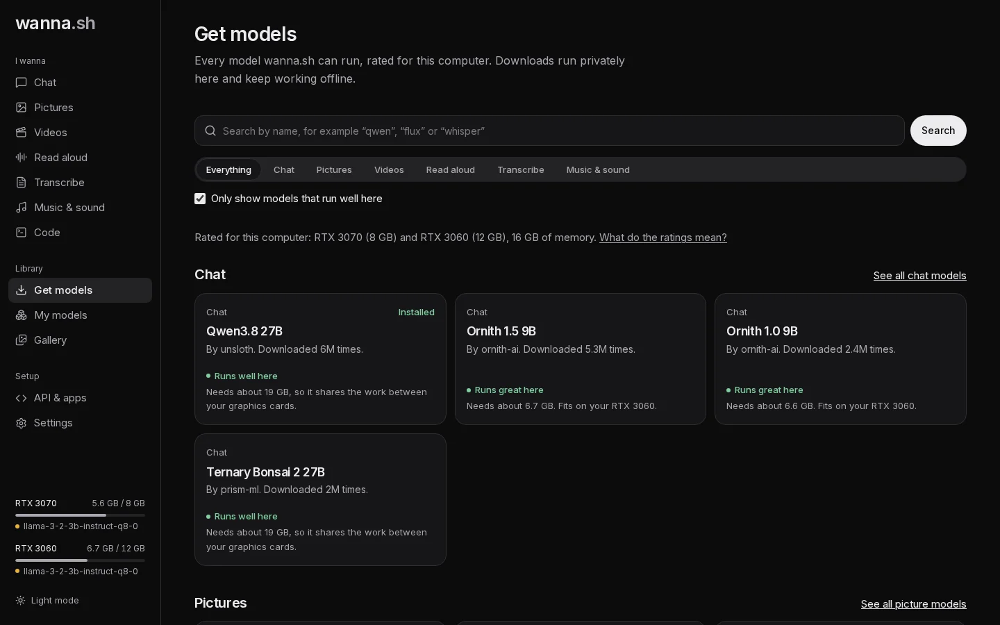

This walks you through downloading your first model and chatting with it.

## 1. Start wanna.sh

- **Windows app:** open **wanna.sh** from the Start menu. It opens in its own window.
- **Mac app:** open **wanna.sh** from Applications or Launchpad. It opens in its own window.
- **Linux, or macOS from the command line:** in a terminal, run `wanna`, leave the terminal open while you use it, and open
  **http://localhost:7860** in your browser.

## 2. Pick a model

Open **Get models** in the sidebar and choose **Chat**. Every model shows how well it runs on your computer:

- **Runs great here**: fits on one of your graphics cards. Fast.
- **Runs well here**: fits when shared across your graphics cards.
- **Runs, but slowly**: part of it runs on the processor.
- **Too big for this computer**.

Choose one marked **Runs great here**. Small, capable models like Llama 3.2 3B or a Qwen model of 8B or smaller are
good first choices. Open it and press **Download**. You can follow the progress at the bottom of the sidebar.

## 3. Chat

Open **Chat**, pick your model from the **Model** menu under the message box, type a message and press **Enter**.

The first message takes a little longer:

- The first time you ever chat, wanna.sh downloads its chat engine (llama.cpp) for your system.
- The model then starts and loads onto your graphics card. You'll see *Starting the model…*.

After that, replies stream in straight away. Under each reply you can see how many tokens it used and how fast it was.

## What next?

- [Attach pictures and documents, and dictate messages](/docs/tutorials/chat/)
- [Make a picture](/docs/tutorials/pictures/)
- [See where your model is running and how much memory it uses](/docs/guides/hardware/)
