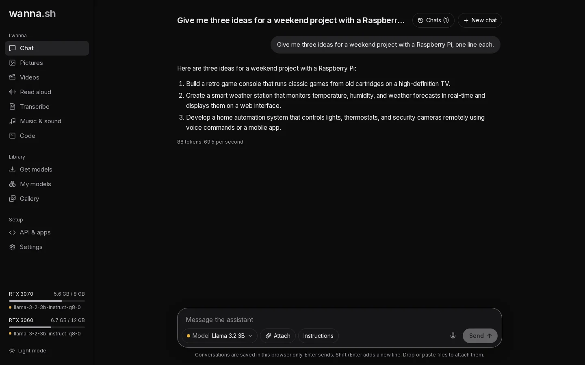

**Chat** is where you talk to a language model: ask questions, draft and rewrite text, summarise documents or get help
with code.

## Send a message

Type in the box at the bottom and press **Enter**. **Shift+Enter** adds a new line. Replies stream in as they're
written; press **Stop** to cut one short.

Choose the model with the **Model** menu under the message box. If you haven't installed a chat model yet, get one
from [Get models](/docs/guides/models/) first.

## Attach pictures and documents

Press **Attach**, or drop or paste files into the message box.

- **Pictures** work with models that can see, such as Gemma 3 and Gemma 4 or Qwen-VL models. Ask "What's in this
  picture?" or "Turn this whiteboard into notes". If the model can't read pictures, wanna.sh tells you before you send.
- **Documents**: PDFs and text files (Markdown, CSV, JSON, HTML, code files and more). wanna.sh extracts the text and
  adds it to your message. If a document is longer than the model can hold in mind, you'll see a note saying how much
  of it was included.

:::note
Scanned PDFs are pictures of pages with no text inside, so there's nothing to extract. Take a screenshot of the page and
attach it as a picture to a model that can see instead.
:::

## Speak instead of typing

Press the microphone button, speak, and press it again to stop. Your words are turned into text in the message box, so
you can check them before sending. This uses your [transcription model](/docs/tutorials/transcribe/), so install one
first (Whisper models work well). Your browser will ask for permission to use the microphone.

## Give the assistant instructions

Press **Instructions** to set guidance the assistant follows for the whole conversation, for example *"You are a
patient tutor. Keep answers short."* The button shows **Instructions (on)** while some are set.

## Manage your chats

Press **Chats** at the top to see your conversations. You can search them, open an old one to carry on, and:

- **Archive** a chat to tidy it away without deleting it, or **Archive all**. Find them again under **Archived**.
- **Delete** a single chat, **Delete archived**, or **Delete all chats**.

Press **New chat** to start fresh.

:::caution
Conversations are saved in your browser only. Clearing your browser's site data, or using a different browser,
starts you with an empty list.
:::

## Longer conversations

How much of a conversation a model can keep in mind is its *memory* (also called context). The default is
**Standard (8K)**, about 6,000 words. For long documents, choose a larger size in **Settings → Chat memory**, or per
model under **My models → Options**. See [Graphics cards and memory](/docs/guides/hardware/).
