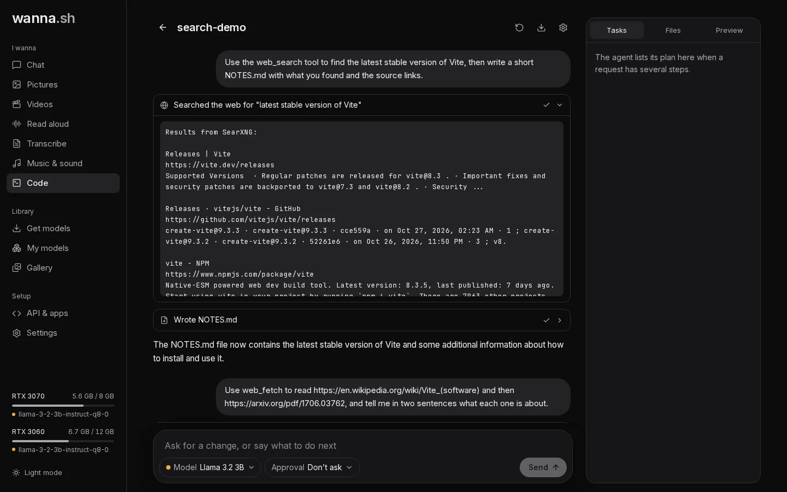

**Code** is a coding agent, similar in spirit to tools like Claude Code, that runs on your own chat model. Describe what
you want to build and it plans the work, writes and edits files, runs commands, searches the web and starts servers you
can preview.

## Before you start

- **Docker** must be installed and running. The agent's commands run inside a Docker container (the *sandbox*), never
  directly on your computer. The first time, wanna.sh prepares the sandbox image, which takes a few minutes.
- **A chat model that can use tools.** In the model menu, models are marked **Can use tools** or **Can't use tools**.
  Bigger models do much better at coding: a 3B model can write a small file, while a model of 14B or more can build a
  multi-file app.

## Create a project

1. Open **Code** and press **New project**.
2. Give it a **Name**, optionally say **What it is** (the agent sees this at the start of every request) and **What do
   you want to build?** (this becomes your first request).
3. Press **Create project**.

Each project is a folder in `~/.wanna/projects/`, which you can open in your own editor at any time. **Download as zip**
gives you a copy.

## Watching it work

Every step the agent takes appears as a card, such as *Read index.html*, *Wrote game.js*, *Edited style.css* (with a
diff of the change), a command it ran, or *Searched the web for "..."*. Click a card to see the details. While the model is thinking, you can see what it's
considering.

The panels on the right show:

- **Tasks**: the agent's plan for requests with several steps, ticked off as it goes.
- **Files**: the project's files. Click one to read it.
- **Preview**: any web server the agent starts in the sandbox on port 3000, 5173, 8000 or 8080, shown live.

Send another message at any time to ask for changes. **Stop** halts the agent; **New conversation** starts a fresh
conversation in the same project.

## Approval

Choose how much the agent may do on its own with **Approval** under the message box:

| Mode | What happens |
| --- | --- |
| **Ask before commands** | Reading and editing files happen right away; commands wait for you. The default. |
| **Ask before any change** | Edits and commands both wait for you. |
| **Don't ask** | The agent works on its own, inside the sandbox. |

When something waits for you, press **Allow**, **Deny**, or **Always allow this command** to stop being asked about that
exact command in this project.

## The agent's tools

| Tool | What it does |
| --- | --- |
| `read_file`, `list_files`, `glob`, `grep` | Find and read files in the project. |
| `write_file`, `edit_file`, `multi_edit` | Create and change files. |
| `bash`, `bash_output`, `kill_shell` | Run commands in the sandbox, including long-running servers in the background. |
| `todo_write` | Keep the task list in the **Tasks** panel. |
| `web_search` | Search the web. |
| `web_fetch` | Read a web page or PDF, such as documentation. |

Files outside the project folder are off limits. The sandbox has internet access (so the agent can install packages)
and is limited to 4 GB of memory and 4 processor cores.

### Web search

Searches go through a private [SearXNG](https://docs.searxng.org/) search engine that wanna.sh runs in Docker on your
computer, so no account or key is needed. If you have a [Brave Search API](https://brave.com/search/api/) key, add it in
**Settings → Web search for Code** and it's used first.

`web_fetch` can't open addresses on your own computer or local network, except the project's own preview ports. That
way the agent can check the app it built, but not reach wanna.sh itself or other devices at home.

## Memory and long tasks

How much the agent can keep in mind is set by **Memory for coding** in the project settings. **Automatic** chooses the
most that fits on your graphics cards. On long tasks, older tool output is shortened to fit, and you'll see a note when
that happens. Give the agent a **What it is** description and it keeps your goals in view.
