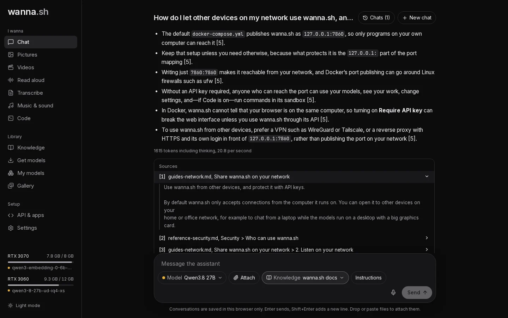
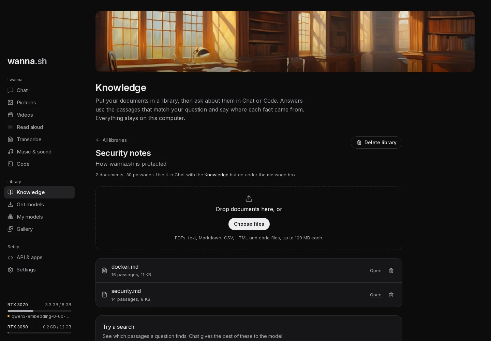

**Knowledge** lets the assistant answer from your own documents: manuals, contracts, notes, reports, code. You put
documents in a *library*, wanna.sh reads them once, and from then on each question finds the passages that match and
gives them to the model. Answers cite those passages with numbers like [1], so you can check where each fact came from.

This is often called *RAG* (retrieval-augmented generation). Everything happens on your computer: your documents are
never uploaded anywhere.

## 1. Set up document search

Open **Knowledge** in the sidebar. The first time, it asks you to download a *search model*: a small model that reads
each passage and records what it means, so questions find the right passages even when they use different words.

The recommended one is **Qwen3 Embedding 0.6B** (639 MB, works in many languages). **EmbeddingGemma 300M** and
**Nomic Embed v1.5** are lighter alternatives. Search models are listed under **Document search** in Get models and
My models, and they run on your graphics card like chat models.

## 2. Make a library and add documents

Give the library a name (for example *Work documents*) and press **Create library**. Then drop documents onto the page,
or press **Choose files**.

- **What you can add:** PDFs, text, Markdown, CSV, HTML and code files, up to 100 MB each. The same kinds of files Chat
  can read.
- **How long it takes:** each document is read, split into passages of a few hundred words, and indexed. A few dozen
  pages take seconds. You'll see progress next to each document.
- **Very long documents:** the first five million characters (about a million words) are indexed.
- **Scanned PDFs** have no text inside, so there's nothing to search. Use a PDF with selectable text.
- **If a document fails** (for example, you added it before the search model finished downloading), its error shows
  next to it with a **Try again** link.

Use **Try a search** to check that a question finds what you expect.

## 3. Ask in Chat

In **Chat**, press **Knowledge** under the message box and tick one or more libraries. Each chat remembers its own
choice. Then ask as usual:

- wanna.sh searches the ticked libraries for passages that match your message (and, for a short follow-up like *"and
  on Windows?"*, your previous question too).
- The best six passages go to the model, with instructions to cite them and to say when your documents don't cover
  the question.
- Under the answer, **Sources** lists the passages by number. Click one to read it. Cited passages come first.

If nothing relevant is found, the assistant says your documents don't cover it, and only then answers from general
knowledge.

## Long attachments in Chat

You don't need a library for a single long document. Attach it in Chat as usual: if it's too long to send to the
model whole, and document search is set up, wanna.sh indexes it into the chat's own private library and searches it
for each question instead of cutting it off. The attachment shows **indexing**, then **searched**.

These chat libraries don't appear on the Knowledge page. Deleting the chat deletes its library too. If you clear your
browser's data, chats disappear but their attachments stay on disk; the Knowledge page shows how much space they use
and has a **Remove all** link.

## In Code

In a [Code](/docs/tutorials/code/) project, press **Knowledge** under the message box to give the agent libraries.
It then gets a `search_knowledge` tool, and searches your documents when a request depends on them: a spec, an API
reference, your team's conventions.

## How search works

Each question is matched two ways, and the results are combined:

- **By meaning**, with the search model, which finds passages that say the same thing in other words.
- **By words**, with full-text search, which finds exact names, error codes and numbers that meaning-based search can
  blur.

At most two passages come from any one document before others get a turn, so answers draw on more sources, and
identical passages are shown once. Each passage carries the document's name and the section it's in, which helps both
the search and the citations.

:::tip[Getting good answers]
- Bigger chat models follow the citation instructions more reliably and combine passages better. Small models (3B)
  find the right passages but can summarise them loosely.
- Libraries work best when they're about one subject. Tick only the libraries that matter for the question.
- Documents with clear headings give better passages and clearer citations.
:::

## Changing the search model

Search models aren't interchangeable: a question can only be compared with passages read by the same model. So each
library keeps the search model it was read with, shown under its name as **Search model**. New libraries use the
search model you installed most recently.

To switch a library to another search model, press **Change or read again**, choose the model and press **Read
documents again**. Every document is read again, with the usual progress. Until each one is done, the library is still
searched by exact words. Choosing the same model reads the documents again too, which picks up any improvements in how
newer versions of wanna.sh split documents into passages.

### If a search model is removed

If you delete a search model that libraries were read with, My models warns you first and names them. Those libraries
keep working, but can only be searched by exact words, not by meaning. Chat says so when it uses one, and the library
shows a notice with a button to read it again with an installed search model.

## Where it's stored

Libraries and their passages are in `wanna.db`, and the original files in the `knowledge/` folder of your
[data folder](/docs/reference/files/). Deleting a document or library deletes both.
