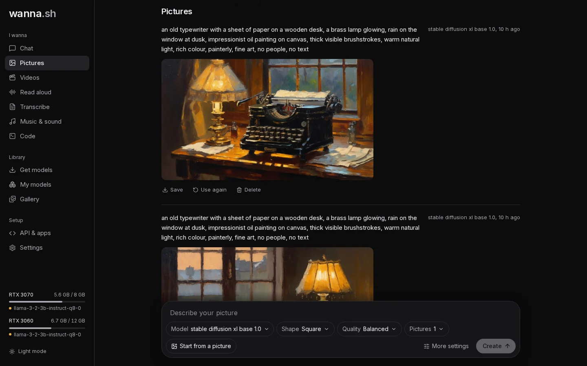

**Pictures** turns a description into an image. You need a picture model first: open **Get models → Pictures**.
Stable Diffusion 1.5 is small and quick; Stable Diffusion XL gives better results if your graphics card has 8 GB or more.

If you installed the Windows or Mac app, or a chat-only install, the first visit to Pictures (or Videos, Read aloud, Transcribe
or Music) shows **One more step: picture, video, voice and music support**. Press **Install** for a one-time download of
the AI libraries (about 3 GB, or 300 MB on a Mac), matched to your graphics card. You can keep chatting meanwhile.

## Describe your picture

Type what you want to see and press **Create**. Be specific about the subject, the setting, the style and the light,
for example:

> an old typewriter on a wooden desk, a brass lamp glowing, rain on the window at dusk, impressionist oil painting

The model starts by itself the first time, then the picture appears above the prompt bar with a progress bar.

## Options

| Option | What it does |
| --- | --- |
| **Model** | Which picture model to use. |
| **Shape** | **Square**, **Wide** or **Tall**. Sizes are chosen to suit each model. |
| **Quality** | **Quick**, **Balanced** or **Best**. Better quality takes more steps, so it's slower. |
| **Pictures** | How many to make at once. |
| **Start from a picture** | Restyle one of your own pictures. **Prompt strength** sets how far it can move from the original: low keeps it close, high changes more. With a model that edits, this reads **Change a picture** (see below). |
| **Style** | A style or subject you [trained](/docs/tutorials/train/) on this model. Shows when the chosen model has one. Put its trigger word in your description. |

Under **More settings**:

| Setting | What it does |
| --- | --- |
| **Things to avoid** | What you don't want, for example *blurry, extra fingers, text*. |
| **Steps** | How many refinement steps to run. Leave empty to follow **Quality**. |
| **Sampler** | How the picture is drawn step by step. **Automatic** works well for most pictures. |
| **Seed** | The same seed and description give the same picture. Leave it on **Random** for variety. |
| **How strongly to use** | With a trained **Style** chosen: how strongly it shows, from 10% to 150%. Lower it if every picture copies it too closely. |

## Change a picture by describing the change

Editing models change a picture you give them as you describe, and keep the rest as it was: *make it a snowy
evening*, *remove the people in the background*, *change the sign to say OPEN*. Find them under **Get models →
Pictures**, marked **Changes pictures you give it** or **Can also change pictures you give it**. Qwen-Image 2.1 does
both (it makes pictures from a description too); Qwen-Image-Edit (and its 2509 and 2511 versions) only edits.

1. Choose the model, press **Change a picture** (or **Add the picture to change**) and pick a picture.
2. Describe the change, then press **Change**.

The result keeps your picture's shape, so **Shape** is hidden while one picture is attached.

## Combine several pictures

Some editing models take several pictures at once and combine them as you describe: two people in one scene, a
person with a product, a product in a new setting.

| Model | Pictures at once |
| --- | --- |
| Qwen-Image 2.1 | Up to 10 |
| Qwen-Image-Edit-2509 and Qwen-Image-Edit-2511 | Up to 3 (Qwen recommends 1 to 3) |
| Qwen-Image-Edit (the original) and other picture models | 1 |

The model menu on the Pictures page says **Combines up to 10 pictures** (or 3) for these models, and so does
**Get models → Pictures**.

1. Choose a model that combines pictures and press **Add pictures**. You can select several at once. The button then
   reads **Add another picture (2 of 10)**, and disappears when the model has all it can take.
2. The pictures are numbered 1, 2, 3 in the order you added them. Refer to them by number in your description, for
   example:

   > the person in picture 1 and the person in picture 2 having coffee together at a café

   > the apple from picture 1 and the banana from picture 2 side by side on a wooden table
3. Choose a **Shape**. **Like picture 1** (the default) uses the first picture's shape; **Square**, **Wide** and
   **Tall** work as usual.
4. Press **Change**.

wanna.sh checks the number of pictures against the model, so a picture never goes unused without you knowing:

- If you select more pictures than the model takes, only the first ones are added, and the page says how many
  weren't.
- If you switch to a model that takes fewer pictures than you've attached, **Change** waits, and the page offers
  **Use** an installed model that can take them all, or **Keep** the first ones.
- From apps, a request with more pictures than the model takes returns an error that names the installed models that
  can take them.

Each extra picture adds time and memory, so start with two. As a guide, two 512 × 512 pictures combined into a
768 × 512 one took about 3 minutes with Qwen-Image 2.1 on an RTX 3060, against under a minute for a picture made from
a description alone.

### Change a pose

Qwen-Image-Edit-2509 and 2511 also take a **pose map** (a stick figure of a body's joints, often called an OpenPose or
keypoint image) as one of the pictures: attach the person as picture 1 and the pose map as picture 2, then describe
it, for example *the person in picture 1 in the pose from picture 2*. Qwen's model card shows this with keypoint maps;
depth and edge maps work the same way. wanna.sh doesn't make pose maps from photos, so use one you already have. A plain
photo of someone in the pose you want, instead of a pose map, may work but isn't something Qwen documents.

These models come as GGUF files and run on stable-diffusion.cpp, which wanna.sh sets up the first time you use one.
They don't need the AI libraries download above. A download includes the parts the model needs to read your
description and to see your picture (from the model's original release when the upload doesn't have them), so it's
bigger than the model file alone. Parts that don't fit on your graphics card are kept in system memory. On a Mac
they need **macOS 26 or newer**: stable-diffusion.cpp is only built for it, and older versions say so when you try one.

:::note[Linux and WSL]
stable-diffusion.cpp has no ready-made Linux build for NVIDIA cards, so wanna.sh builds one for your card (once, in
10 to 20 minutes). That needs the CUDA toolkit, cmake and git. Without them it uses the processor, which is very slow,
and the Pictures page says what to install; wanna.sh builds for your card the next time once they're there.
[Set up your graphics card for these models](/docs/guides/linux-gpu-pictures/) walks through it step by step.
:::

## After it's made

- **Save** downloads the picture.
- **Use again** puts the same description and settings back in the prompt bar, so you can try a variation.
- **Delete** removes it.

Everything you make is also kept in the **Gallery**, and in the `outputs` folder of your
[data folder](/docs/reference/files/).

:::tip
Some models, such as FLUX.1 [dev], ask you to accept their licence on Hugging Face first. Accept it on the model's
Hugging Face page, then add a token in **Settings → Hugging Face account**.
:::
