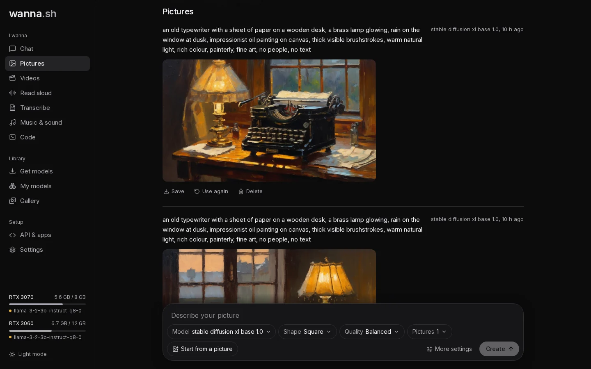

**Pictures** turns a description into an image. You need a picture model first: open **Get models → Pictures**.
Stable Diffusion 1.5 is small and quick; Stable Diffusion XL gives better results if your graphics card has 8 GB or more.

If you installed the Windows or Mac app, or a chat-only install, the first visit to Pictures (or Videos, Read aloud, Transcribe
or Music) shows **One more step: picture, video, voice and music support**. Press **Install** for a one-time download of
the AI libraries (about 3 GB, or 300 MB on a Mac), matched to your graphics card. You can keep chatting meanwhile.

## Describe your picture

Type what you want to see and press **Create**. Be specific about the subject, the setting, the style and the light,
for example:

> an old typewriter on a wooden desk, a brass lamp glowing, rain on the window at dusk, impressionist oil painting

The model starts by itself the first time, then the picture appears above the prompt bar with a progress bar.

## Options

| Option | What it does |
| --- | --- |
| **Model** | Which picture model to use. |
| **Shape** | **Square**, **Wide** or **Tall**. Sizes are chosen to suit each model. |
| **Quality** | **Quick**, **Balanced** or **Best**. Better quality takes more steps, so it's slower. |
| **Pictures** | How many to make at once. |
| **Start from a picture** | Restyle one of your own pictures. **Prompt strength** sets how far it can move from the original: low keeps it close, high changes more. |

Under **More settings**:

| Setting | What it does |
| --- | --- |
| **Things to avoid** | What you don't want, for example *blurry, extra fingers, text*. |
| **Steps** | How many refinement steps to run. Leave empty to follow **Quality**. |
| **Sampler** | How the picture is drawn step by step. **Automatic** works well for most pictures. |
| **Seed** | The same seed and description give the same picture. Leave it on **Random** for variety. |

## After it's made

- **Save** downloads the picture.
- **Use again** puts the same description and settings back in the prompt bar, so you can try a variation.
- **Delete** removes it.

Everything you make is also kept in the **Gallery**, and in the `outputs` folder of your
[data folder](/docs/reference/files/).

:::tip
Some models, such as FLUX.1 [dev], ask you to accept their licence on Hugging Face first. Accept it on the model's
Hugging Face page, then add a token in **Settings → Hugging Face account**.
:::
